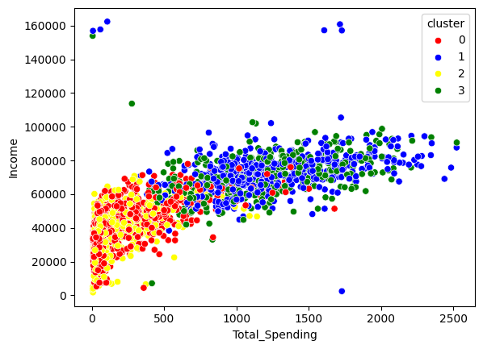

# 🛒 SmartCart: Customer Segmentation

Unsupervised ML project that groups customers into 4 segments
using PCA, K-Means and Agglomerative Clustering.

## Steps
- Data cleaning and outlier removal
- Feature engineering (Total Spending, Age, Tenure)
- Scaling + PCA
- Choosing K with Elbow Method and Silhouette Score
- Cluster analysis

## Tech Stack
Python, Pandas, Scikit-learn, Seaborn, Matplotlib

## Result

## Acknowledgement
Guided by Shradha Khapra Ma'am (Apna College)
